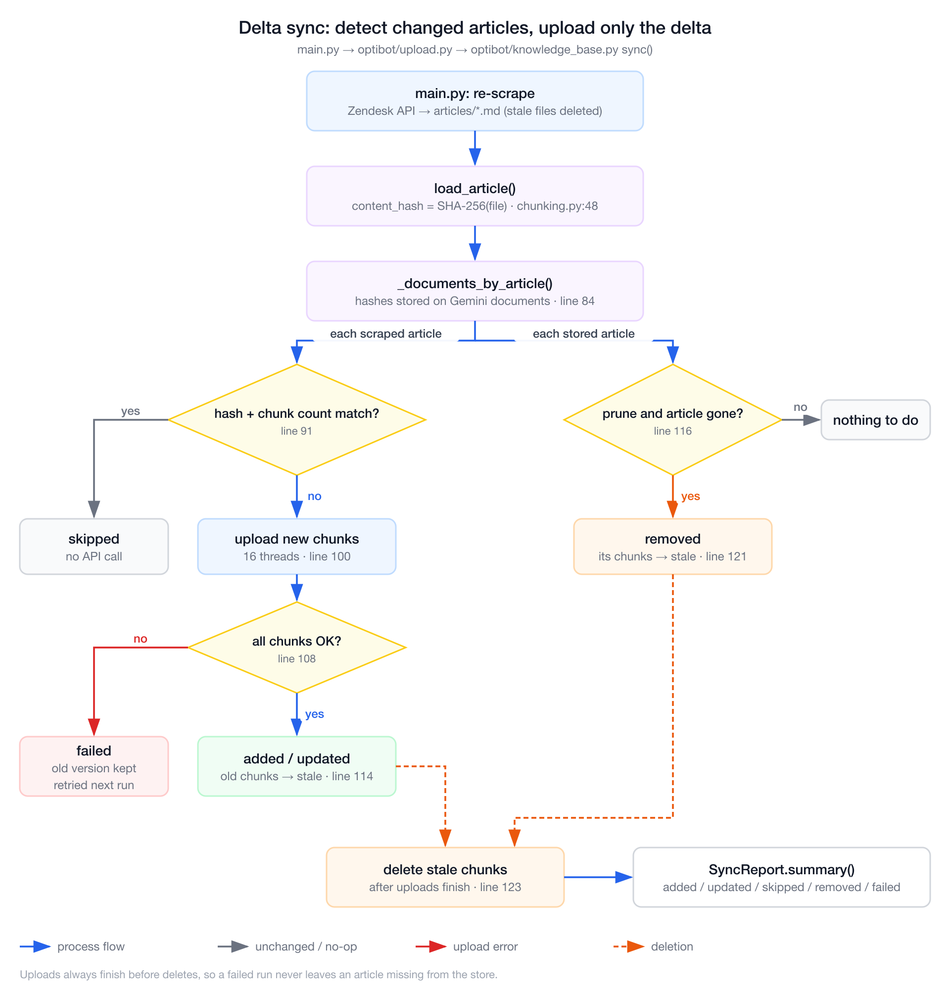

# Assistant and vector store (Google Gemini File Search)

```bash
uv run python -m optibot.upload --prune       # sync articles/ -> File Search store "optibot-kb"
uv run python -m optibot.assistant "How do I add a YouTube video?"
```

We use Gemini because OpenAI shut down the Assistants API on 2026-08-26.

The store is found by its display name (`GEMINI_STORE_DISPLAY_NAME`, default `optibot-kb`) and created on
the first run, so no store id is saved anywhere.

The system prompt is `SYSTEM_PROMPT` in `optibot/assistant.py`. It is word-for-word the assignment text.

The upload takes every file in `articles/`. Which articles are there is decided by the scraper; see
[scraping.md](scraping.md).

## Chunking (`optibot/chunking.py`)

Chunks are built on our side and follow the article's headings:

- Text is split into blocks at blank lines. A fenced code block always stays one block.
- Blocks are packed into chunks of up to 450 words.
- A heading starts a new chunk once the current chunk has at least 120 words. Smaller sections are merged
  with the one before them.
- A single block over the budget is split by line, then by word. Code pieces get their fences re-added.
- Every chunk starts with `# Title`, `Article URL: …` and `Section: H2 > H3`. Whichever chunk the retriever
  returns, the model can still cite its article.
- No overlap is used, because each chunk carries its own section header.
- Links between scraped articles become live help-center URLs.

Gemini's whitespace chunker splits at 512 words, so it never re-splits our chunks. That makes 1 uploaded
document equal 1 embedded chunk, and the logged chunk count is exact.

## Delta sync (`optibot/knowledge_base.py`, `sync()`)

Each document carries `article_id`, `content_hash`, `title`, `url` and `chunk` metadata. The sync uses this
metadata as its state, so it needs no local database:

- `content_hash` is the SHA-256 of the article's Markdown file (`chunking.py`, `load_article`). The file
  includes `updated_at`, and the hash also mixes in `CHUNKER_VERSION`.
- **skipped:** the stored hashes and the chunk count already match the local article.
- **added / updated:** anything else. The article's new chunks are uploaded first and its old chunks are
  deleted afterwards, so a failure never leaves an article missing.
- **failed:** an upload error keeps the previous version, and the next run retries the article.
- **removed:** with `--prune`, articles in the store that no longer exist locally are deleted.



Source of the diagram: [delta-sync.svg](delta-sync.svg). Example log line:
`embedded 17 chunks from 3 files | added=3 updated=0 skipped=0 removed=0 failed=0`.
